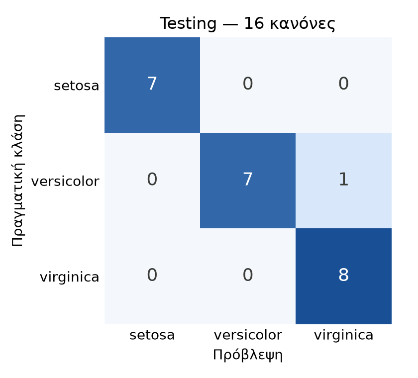
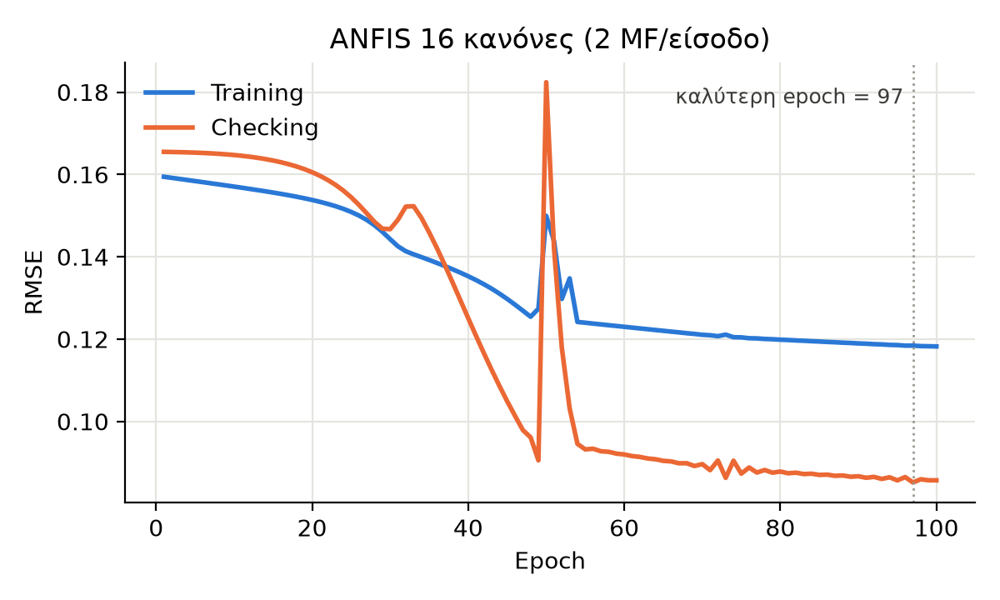

# ANFIS from scratch: IRIS classification with a TSK fuzzy model

A first-order Takagi–Sugeno–Kang (TSK) fuzzy classifier for the IRIS dataset, implemented as an
ANFIS (Adaptive Neuro-Fuzzy Inference System) from scratch in Python/NumPy. No ANFIS library is used.

Coursework for *Intelligent Systems* (Ευφυή Συστήματα), Department of Information and
Electronic Engineering, International Hellenic University (IHU), 2026–27.

> **Για τον καθηγητή:** 1η εργασία (Ασαφή Συστήματα), θέμα #3 «Κατάταξη δειγμάτων IRIS».
> Το paper (πρότυπο IEEE) βρίσκεται στο `paper/`. Όλα τα αποτελέσματα αναπαράγονται με τις
> εντολές της ενότητας *How to run* (seed = 42).

## Results (Testing set, 23 samples)

| Model | Parameters | Training | Checking | Testing |
|---|---:|---:|---:|---:|
| ANFIS, 16 rules (2 MF/input) | 96 | 99.04% | 100% | 95.65% |
| ANFIS, 81 rules (3 MF/input) | 429 | 98.08% | 100% | 95.65% |
| 3 × ANFIS one-vs-rest | 288 | 99.04% | 100% | 95.65% |

The single Testing error is a *versicolor* sample (6.7, 3.0, 5.0, 1.7) that lies inside the
*virginica* region. All three architectures make the same mistake, so it comes from the
versicolor/virginica overlap in the data, not from the model.

<p align="center">
  
  
</p>

## Method

- Data split: random, stratified 70 / 15 / 15 → Training 104, Checking 23, Testing 23.
- Model: 4 inputs, Gaussian membership functions, grid partition (16 rules),
  first-order TSK consequents `f = p·x + r`, 5-layer ANFIS.
- Hybrid learning (as in MATLAB's `anfis`): consequents by ridge least squares (λ = 0.01),
  premise parameters (centres, widths) by gradient descent with numerical gradients and an
  adaptive step size.
- Early stopping: keep the epoch with the lowest Checking RMSE.
- Output → class: `class = clip(round(y), 1, 3)`, i.e. decision thresholds 1.5 and 2.5.
  A one-vs-rest variant (`argmax` of 3 ANFIS) is used to check that this ordinal coding
  does not affect the result.

## How to run

```bash
pip install -r requirements.txt
python step01_data.py       # stratified split  -> data/*.csv
python step03_train.py      # train 16- and 81-rule ANFIS -> results/
python step04_evaluate.py   # accuracy, confusion matrix, misclassifications
python step05_ovr.py        # optional: one-vs-rest comparison
python step06_example.py    # layer-by-layer computation for one sample
```

All numbers in this README and in the paper were reproduced from a clean copy of the
repository (same split, same accuracy, same misclassified sample). Tested with Python 3.13 and 3.15.

## Paper

`paper/paper.tex` is the report in IEEE conference format (Greek, LuaLaTeX). The compiled
version is `paper/paper.pdf`. To rebuild it, upload `paper/` to Overleaf and select the
LuaLaTeX compiler.

## Structure

```
step01_data.py       stratified Training / Checking / Testing split
step02_anfis.py      the ANFIS class (layers, least squares, gradient step)
step03_train.py      hybrid training + error curves + membership-function plots
step04_evaluate.py   evaluation on the Testing set
step05_ovr.py        3 × ANFIS one-vs-rest comparison
step06_example.py    worked example through all 5 layers
results/             figures and numeric results
paper/               paper.tex, paper.pdf and the figures it uses
```

## Author

Apostolos Daglis, International Hellenic University
